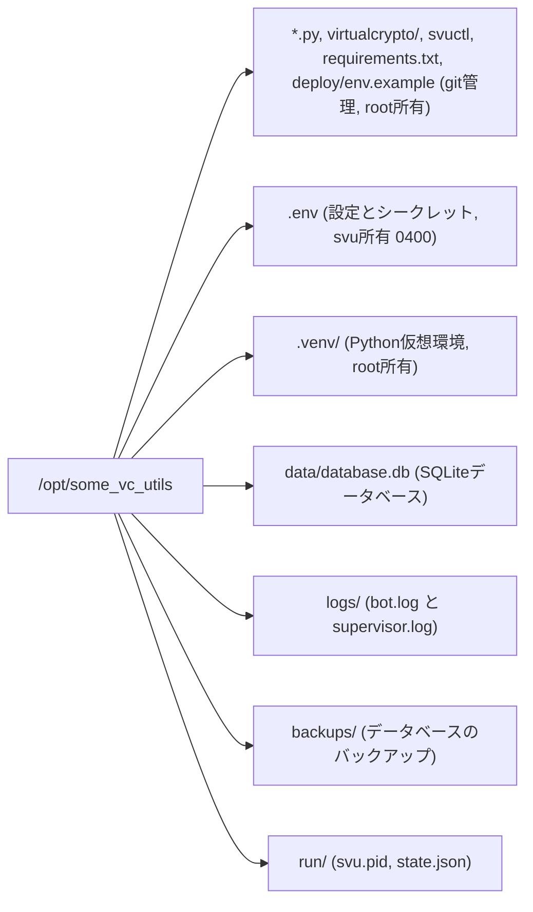

# Some VC Utils

「Some VC Utils」は、Discord上で[VirtualCrypto](https://vcrypto.sumidora.com)を簡単に利用するためのユーティリティボットです。
特定のロールを持つメンバーへの通貨の配布や、メッセージ付きの送金など、VirtualCryptoをより便利に活用するための機能を提供します。

*   [サーバーにボットを導入](https://discord.com/oauth2/authorize?client_id=1391028883868094516&permissions=68672&integration_type=0&scope=bot)
*   [サポートサーバー](https://discord.gg/rqpSGFSRUH)

## コマンド

### 一般コマンド

*   `/info`: ボットに関する情報を表示します。
*   `/rain <unit> <amount_per_user> <role>`: 指定したロールを持つすべてのメンバーに、指定された量の通貨を配布します。一部のメンバーへの送金に失敗した場合も残りのメンバーへの配布を続け、配布できた人数と失敗したメンバーを結果に表示します。
*   `/send_with_msg <unit> <user> <amount> <message>`: ダイレクトメッセージと共にユーザーに通貨を送信します。
*   `/receive_msg <True|False>`: トランザクションに関するダイレクトメッセージの受信を有効または無効にします。

### 報酬プールコマンド

*   `/reward_pool init <unit>`: 報酬プールを特定の通貨単位で初期化します。残高のあるプールの通貨単位を変更すると、残高は実行者に返金されます。(サーバー管理権限が必要)
*   `/reward_pool set <reward_type> <amount> <cooldown_seconds>`: 特定のアクションに対する報酬ルールを設定します。(サーバー管理権限が必要)
*   `/reward_pool delete <reward_type>`: 報酬ルールを削除します。(サーバー管理権限が必要)
*   `/reward_pool info`: 報酬プールの現在のステータスとルールを表示します。
*   `/reward_pool deposit <amount>`: 報酬プールに通貨を入金します。(サーバー管理権限が必要)

### ボット管理者向け

`SVU_ADMIN_IDS` に登録したユーザーのみ使用できます。

*   `/refresh`: デバッグ用の空コマンドです。
*   `@ボット kill`: ボットを正常に停止します。終了コード0で終了するため、`svuctl` のスーパーバイザーも再起動せずに停止します。

## 主な機能

*   **通貨の配布 (Rain):** 指定したロールを持つすべてのメンバーに通貨を均等に配布します。
*   **メッセージ付き送金:** 他のユーザーにパーソナライズされたダイレクトメッセージを添えて通貨を送金します。
*   **DM受信設定:** ユーザーはトランザクションに関するDM通知を受け取るかどうかを選択できます。
*   **発言報酬:** サーバーでのメッセージ送信に対してユーザーに報酬を与えます。
*   **参加報酬:** サーバーへの参加に対してユーザーに報酬を与えます。

報酬は、プール残高の差し引きとクールダウンの記録を1つのトランザクションで確定してから送金します。
同じユーザーへのイベントが同時に届いても支払いは1回だけで、プール残高が負になることはありません。
送金に失敗した場合は、差し引いた残高とクールダウンを元に戻し、ログに記録します。

## 追加予定

*   追加の報酬トリガー(例: リアクション、ボイスチャンネルでの活動)。
*   設定を簡単にするためのWebダッシュボード。

## 導入方法

### 前提

*   Ubuntu 24.04 (Python 3.12) を想定しています。`python3`、`python3-venv`、`git` が必要です。
*   ボットに関するファイルはすべてクローンしたディレクトリ (以下 `/opt/some_vc_utils`) の中に置かれます。systemd や crontab は使いません。
*   ディレクトリの外に必要なものは、ボットを実行するOSユーザー `svu` だけです。

### ディレクトリ構成



`.env`、`.venv/`、`data/`、`logs/`、`backups/`、`run/` は git の管理対象外です。
パスはすべてソースファイルの位置から決まるため、どのディレクトリから実行しても同じ場所が使われます。

### 権限

*   コード (`*.py`、`virtualcrypto/`、`svuctl`、`.venv/`) は root が所有し、`svu` は書き込めません。
*   `svu` が書き込めるのは `data/`、`logs/`、`backups/`、`run/` だけです。
*   `.env` は `svu` が所有し、モード `0400` で `svu` だけが読めます。
*   `svuctl` を root で実行すると、ボットとバックアップは `svu` として実行されます。root 以外で実行した場合は、実行したユーザーのまま動作します。

### 初回セットアップ

1.  実行用ユーザーを作成します:
    ```bash
    useradd --system --user-group --no-create-home --home-dir /nonexistent --shell /usr/sbin/nologin svu
    ```

2.  リポジトリをクローンします:
    ```bash
    git clone https://github.com/h4ribote/some_vc_utils.git /opt/some_vc_utils
    cd /opt/some_vc_utils
    ```

3.  設定ファイル `.env` を作成し、値を入力します:
    ```bash
    cp deploy/env.example .env
    ```

4.  既存のデータベースを移行する場合は、`data/database.db` として配置します。テーブル構成は従来と同じなので、そのまま使えます:
    ```bash
    mkdir -p data && cp /path/to/old/database.db data/database.db
    ```

5.  セットアップを実行します。`.venv` の作成、`requirements.txt` のインストール、`data/`、`logs/`、`backups/`、`run/` の作成と、上記の権限の適用を行います:
    ```bash
    ./svuctl setup
    ```

6.  ボットを起動します:
    ```bash
    ./svuctl start
    ```

### 設定 (`.env`)

実際の環境変数が設定されている場合は、`.env` の値より優先されます。
必須の値が欠けているか不正な場合、ボットは問題のある変数をすべて表示して終了コード78で終了し、スーパーバイザーは再起動しません。

| 変数 | 必須 | 説明 |
| --- | --- | --- |
| `SVU_DISCORD_TOKEN` | はい | Discordボットのトークン |
| `SVU_ADMIN_IDS` | はい | ボット管理者のDiscordユーザーID (カンマ区切り) |
| `SVU_VC_CLIENT_ID` | はい | VirtualCryptoのクライアントID |
| `SVU_VC_CLIENT_SECRET` | はい | VirtualCryptoのクライアントシークレット |
| `SVU_BACKUP_INTERVAL_HOURS` | いいえ | 自動バックアップの間隔 (時間、既定値 6) |
| `SVU_BACKUP_RETENTION` | いいえ | 保持するバックアップの数 (既定値 28) |
| `SVU_LOG_LEVEL` | いいえ | `DEBUG`、`INFO`、`WARNING`、`ERROR` のいずれか (既定値 `INFO`) |
| `SVU_LOG_MAX_BYTES` | いいえ | `logs/bot.log` をローテーションするサイズ (バイト、既定値 10485760) |
| `SVU_LOG_BACKUP_COUNT` | いいえ | ローテーション後に残すログファイルの数 (既定値 5) |

### `svuctl` の使い方

| コマンド | 内容 |
| --- | --- |
| `./svuctl setup` | `.venv` の作成、依存関係のインストール、ディレクトリ作成と権限の適用。`.env` が無い場合は中止します |
| `./svuctl start` | スーパーバイザーをバックグラウンドで起動し、PIDを `run/svu.pid` に書き込みます。起動済みの場合は拒否します |
| `./svuctl stop [--timeout 秒]` | SIGTERM で停止します。タイムアウト (既定値30秒) を過ぎても終了しない場合に限り SIGKILL を送り、その旨を表示します |
| `./svuctl restart` | 停止してから起動します |
| `./svuctl status [-n 行数]` | 稼働状況、PID、稼働時間、起動後の再起動回数、ログの末尾を表示します |
| `./svuctl logs [-f] [-n 行数] [--supervisor]` | `logs/bot.log` (または `logs/supervisor.log`) を表示します。`-f` で追跡します |
| `./svuctl backup` | データベースのバックアップを今すぐ作成します。ボットが停止中でも使えます |
| `./svuctl update` | `git pull --ff-only` と `setup` を実行し、ボットが起動中だった場合は再起動します |

スーパーバイザーはボットが0以外の終了コードで終了すると再起動します。
再起動までの待ち時間は1秒から始めて倍々に増え、上限は300秒です。ボットが10分以上動き続けた後の終了では、待ち時間は1秒に戻ります。
ボットが終了コード0で終了した場合 (`kill` コマンドなど) は、スーパーバイザーも終了して `run/svu.pid` を削除します。
`stop` で送られた SIGTERM はスーパーバイザーからボットに転送され、ボットは Discord から正常に切断してから終了します。

### サーバー再起動後

自動起動は設定していません。サーバーを再起動した後は、手動で起動してください:

```bash
cd /opt/some_vc_utils && ./svuctl start
```

`run/svu.pid` が残っていても、そのPIDがこのリポジトリのスーパーバイザーでなければ古いファイルとして扱われ、自動的に削除されます。

### ログ

ボットのログは標準出力と `logs/bot.log` に出力され、`SVU_LOG_MAX_BYTES` を超えるとローテーションされます。
discord.py のログも同じ出力先に記録されます。トークンとクライアントシークレットはログ上で `[REDACTED]` に置き換えられます。
スーパーバイザーの記録と、ボットが標準エラーに出力した内容は `logs/supervisor.log` に記録されます。

## バックアップ

ボットは稼働中、`SVU_BACKUP_INTERVAL_HOURS` ごとに SQLite のバックアップAPIで整合性のあるコピーを `backups/database-<UTC時刻>.db` に作成し、`SVU_BACKUP_RETENTION` を超えた古いものから削除します。
次回のバックアップは最新のバックアップから1間隔後に行われるため、ボットを再起動しても間隔は変わりません。
バックアップに失敗した場合はログに記録され、ボットは動作を続けます。
`./svuctl backup` で同じバックアップを手動で作成できます。

復元するときは、ボットを停止してからバックアップファイルを `data/database.db` にコピーします:

```bash
./svuctl stop
cp backups/database-<UTC時刻>.db data/database.db
chown svu:svu data/database.db && chmod 600 data/database.db
./svuctl start
```

## データベース

このボットは、報酬設定やユーザーのクールダウン情報を保存するためにSQLiteデータベース (`data/database.db`) を使用します。テーブルは `db_utils.py` で作成され、対応するデータ構造は `db_structs.py` で定義されています:

*   **`reward_pools`**: 各サーバーの報酬プールの残高を保存します。
    *   `guild_id`: サーバーのID。
    *   `unit`: 報酬プールの通貨単位。
    *   `pool_balance`: 報酬プールの現在の残高。
*   **`reward_configs`**: 各サーバーの報酬設定を保存します。
    *   `config_id`: 設定の一意なID。
    *   `guild_id`: サーバーのID。
    *   `reward_type`: 報酬をトリガーするイベントの種類(例: `message`、`server_join`)。
    *   `amount`: 報酬として付与する通貨の量。
    *   `cooldown_seconds`: ユーザーが同じ種類の報酬を再度受け取るまでのクールダウン期間(秒)。
*   **`user_reward_cooldowns`**: クールダウンを適用するために、ユーザーが最後に報酬を受け取った時刻を記録します。
    *   `user_id`: ユーザーのID。
    *   `guild_id`: サーバーのID。
    *   `reward_type`: 報酬の種類。
    *   `last_triggered_timestamp`: ユーザーが最後に報酬を受け取ったUNIXタイムスタンプ。
*   **`receive_msg`**: `/send_with_msg` のDM通知を受け取るユーザーを記録します。
    *   `user_id`: ユーザーのID。

## 開発

テストとリンタは `requirements-dev.txt` でインストールします:

```bash
.venv/bin/pip install -r requirements-dev.txt
.venv/bin/python -m pytest tests
.venv/bin/ruff check .
```
