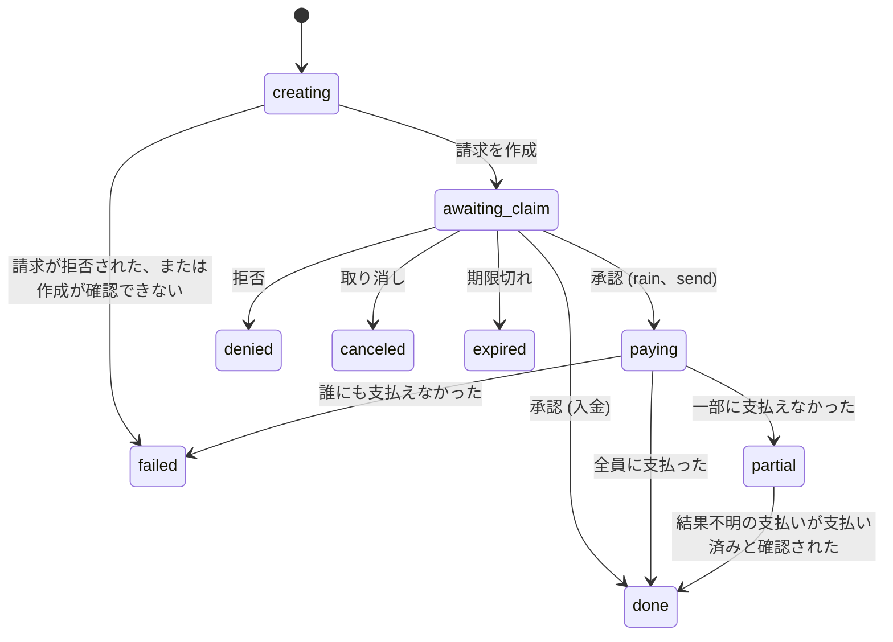

# Some VC Utils の設計

この文書は、操作、支払い、報酬、Webhook がどう連携するかを説明する。
配備と設定は [operations.md](operations.md) を参照する。

## 原則

* お金を動かす処理は、まずデータベースに行として記録し、送金はその後に worker が行う。送金の要求には行から決まる `Idempotency-Key` を付けるため、同じ送金を何度送っても VirtualCrypto 上では一度しか実行されない。
* 補償 (返金、プールへの戻し、クールダウンの取り消し) は、VirtualCrypto が要求を拒否したと確定したときにだけ行う。応答がない、サーバーエラー、レート制限などで結果が分からないときは、同じキーで再送する。
* 状態遷移はすべて1つのデータベーストランザクションで行い、同じ結果が複数の経路から届いても一度しか適用されない。

## 請求による操作

`/rain`、`/send`、報酬プールへの入金は「操作」として記録される。
操作の行を `creating` で保存してから、`svu_operation` に操作の ID を入れたメタデータ付きで、実行した人への請求を作る。

請求の結果は、次の3つの経路のうち最初に届いたもので確定する。

| 経路 | 内容 |
| --- | --- |
| Webhook | 承認または拒否されると VirtualCrypto が type 2 のイベントを送る。api が受信箱に保存し、worker が適用する |
| 照合 | worker が承認待ちの請求を VirtualCrypto に問い合わせる。Webhook を取りこぼしても進む |
| 期限切れ | 期限を過ぎた請求を worker が取り消し、`expired` にする。取り消す前に承認や拒否が済んでいれば、その結果が優先される |

請求の作成に応答がなかった操作は `creating` のまま残る。worker は作成から60秒経った `creating` の操作について、VirtualCrypto の請求一覧からメタデータが一致する請求を探し、見つかればその請求で処理を続ける。5分経っても見つからなければ `failed` にする。

rain と send の支払い先は、操作の作成時に `held` の支払いとして記録され、承認で `pending` になり、取り消しなどで `canceled` になる。
入金は承認された時点でサーバーのプール残高に加算される。

操作の状態が変わるたびに、Discord への通知が outbox に積まれる。worker はその時点の状態を描画し、コマンドの返信を編集する。
返信を編集できない場合 (Discord の interaction トークンの期限切れなど) は、確定した結果だけを実行した人の DM に送る。ダッシュボードから始めた入金の結果も DM に届く。

## 支払いの outbox

すべての送金は `payouts` の行である。

| 用途 | 送金の方法 | VirtualCrypto に拒否されたときの補償 |
| --- | --- | --- |
| `rain`、`send` | Bot のウォレットから送金 | 同じ額を実行した人に返金する支払いを作る |
| `reward` (支払い元 `wallet`) | Bot のウォレットから送金 | プール残高に戻し、クールダウンを取り消す |
| `reward` (支払い元 `issue`) | サーバーの発行枠から発行 | クールダウンを取り消す |
| `withdraw` | Bot のウォレットから送金 | プール残高に戻す |
| `refund` | Bot のウォレットから送金 | なし。管理ページに表示される |

worker は期限の来た支払いを `FOR UPDATE SKIP LOCKED` で取り出し、120秒の貸し出し期間を設定してから送る。送っている途中で worker が止まっても、貸し出し期間の後に同じキーで再送される。
1つの rain の支払い先は最大100件ずつまとめて、1回の一括送金 (VirtualCrypto 上ですべて成功するかすべて失敗する) で送る。一括送金が拒否された場合は1件ずつに分けて送り直し、拒否された相手だけを失敗にする。

結果が分からない失敗は、5秒から始めて倍々に、最大1時間の間隔で再送する。
作成から5日経っても結果が分からない支払いは `unknown` になり、自動では再送も補償もしない。VirtualCrypto が冪等キーを覚えている間に、管理者が VirtualCrypto の履歴を確認し、ダッシュボードの管理ページで「支払い済み」か「支払われていない」(補償する) を記録する。

`send` の支払いが完了し、受取人がメッセージの受け取りを有効にしていれば、メッセージ付きの DM が outbox に積まれる。

## 報酬

メッセージの送信とサーバーへの参加のたびに、bot は1つのトランザクションで次を行う。

1. サーバーの報酬ルールと支払い元を確認する。
2. そのメンバーと種類のクールダウンの行をロックし、前回から `cooldown_seconds` が経っているか確認する。同じメンバーへの同時のイベントは、このロックで直列になる。
3. 支払い元が `wallet` なら、プール残高が報酬額以上のときだけ減算する。足りなければ何もしない。`issue` なら、有効な発行許可があることを確認する。
4. クールダウンを記録し、`pending` の支払いを作る。

ルールのないサーバーのイベントでデータベースに触れないよう、bot はルールのあるサーバーと種類を記憶し、30秒ごとに読み直す。ダッシュボードで変えたルールは、この間隔で bot に反映される。

報酬の支払いが拒否されたときにクールダウンを戻すのは、記録されているクールダウンがその報酬で書いたものと同じ場合だけである。後の報酬が書き換えていれば、そちらを残す。

## 発行の許可

支払い元を `issue` にすると、VirtualCrypto に `vc.issue` の許可を申請する (device flow)。
サーバーの管理者が `/grant approve` で承認すると、VirtualCrypto が type 3 のイベントを送る。worker はそれを受けて (届かなくても15秒ごとに) トークンを取りに行き、サーバーの通貨を報酬の通貨にして支払い元を切り替え、申請した人に DM で知らせる。

トークンは `SVU_SECRET_KEY` から導いた鍵で暗号化して保存する。アクセストークンは期限の10分前にリフレッシュトークンで更新する。
発行が認証エラーで拒否された場合は、トークンを更新して一度だけ再送する。それでも拒否されるか、更新が拒否されれば、許可は取り消されたものとして扱う。
許可が取り消されると (scopes が空の type 3 イベントを含む)、報酬は止まり、申請した人に DM で知らせる。取り消しのイベントがこの Bot が持つ許可と別の `grant_id` を名指ししている場合は、何もしない。

## Webhook

`/vc/webhook` は VirtualCrypto の配送を次のように扱う。

1. `X-Signature-Ed25519` と `X-Signature-Timestamp` を、アプリケーションの公開鍵で検証する。署名が一致しないか、時刻が現在から300秒より離れていれば 401 を返す。
2. type 1 (PING) には `{"type": 1}` を返す。VirtualCrypto は登録時と定期的に、正しい署名の PING と不正な署名の PING を送り、それぞれ 200 と 401 が返ることを確かめる。
3. それ以外のイベントは受信箱に保存して、すぐに 200 を返す。適用は worker が行う。知らない種類のイベントは無視する。

公開鍵は worker が VirtualCrypto から取得してデータベースに保存する。api は公開鍵を60秒ごとに読み直し、署名が一致しないときにも一度読み直す。
worker は Webhook の URL を変更する前に公開鍵を保存する。VirtualCrypto は URL の変更時にその場で検証の PING を送るためである。

適用に失敗したイベントは次の周期で再試行され、10回失敗するとエラーを記録して処理済みにする。請求の結果は照合でも確定するため、イベントを諦めても操作は進む。

## worker のジョブ

worker は1つのプロセスで次のジョブを並行して実行する。間隔は前回の実行の終了から測る。失敗した実行はログに記録され、次の周期で再試行され、ほかのジョブには影響しない。

| ジョブ | 間隔 (秒) | 内容 |
| --- | --- | --- |
| `payouts` | 1 | 期限の来た支払いを送る |
| `webhooks` | 1 | 受信箱のイベントを適用する |
| `messages` | 1 | Discord への通知を送る。8回失敗するか、相手に届かないことが確定すると諦める |
| `expire_claims` | 10 | 期限を過ぎた請求を取り消す |
| `reconcile_claims` | 30 | 承認待ちの請求を問い合わせ、作成が確認できない請求をメタデータで探す |
| `grant_requests` | 3 | 期限の来た発行許可の申請についてトークンを取りに行く |
| `refresh_grants` | 60 | 期限の近い発行許可のトークンを更新する |
| `vc_sync` | 300 | VirtualCrypto アプリの公開鍵を記録し、Webhook の URL、受け取る通知、リフレッシュトークンの利用を設定する |
| `backup` | 60 | バックアップの期限が来ていれば取る |
| `prune` | 3600 | 30日より前に処理済みの Webhook と通知、期限切れのセッションとログインの状態を削除する |

## データベース

PostgreSQL のスキーマは `svu/db/tables.py` で定義し、Alembic のマイグレーション (`svu/db/migrations`) が同じものを作る。
すべての接続は READ COMMITTED、UTC で動き、ロック待ちは5秒、文の実行は30秒で打ち切られる。
