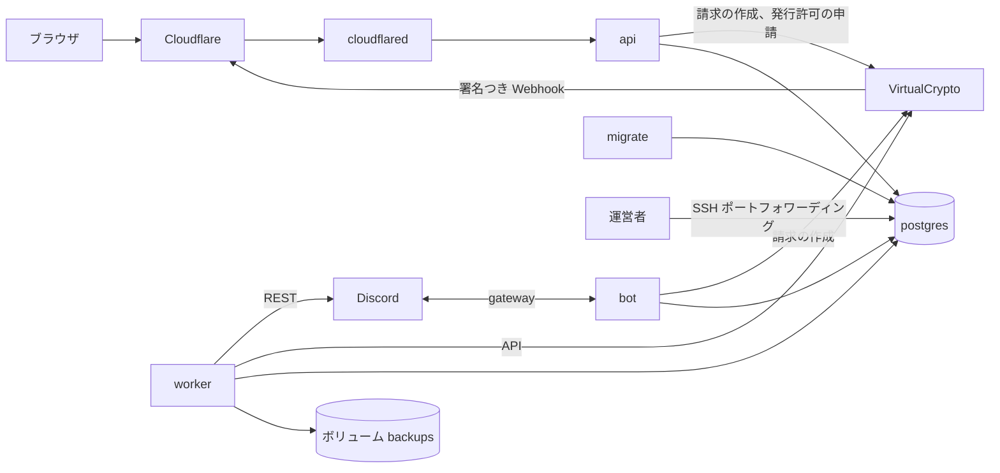

# Some VC Utils の運用

このガイドは、Docker Compose と Cloudflare Tunnel で Some VC Utils を配備して運用する運営者に向けたものである。
仕組みは [architecture.md](architecture.md)、ダッシュボードは [dashboard.md](dashboard.md) で説明する。

## サービス

1つのコンテナイメージがすべての役割を担い、`svu` コマンドのサブコマンドが役割を選ぶ。
`compose.yaml` は次のサービスを定義する。

| サービス | コマンド | 役割 |
| --- | --- | --- |
| `postgres` | `postgres:17` イメージ | データベース。`pgdata` ボリュームに保存される |
| `migrate` | `svu migrate` | マイグレーションを最新まで適用して終了する。`build` を持つ唯一のサービスで、共有の `svu:local` イメージをビルドする |
| `api` | `svu api` | VirtualCrypto の Webhook (`/vc/webhook`)、ダッシュボード、`/health`。`cloudflared` を通じてのみ外部から到達できる |
| `bot` | `svu bot` | Discord の gateway 接続、スラッシュコマンド、報酬イベントの受付 |
| `worker` | `svu worker` | 支払い、Webhook の適用、Discord への通知、請求の照合と期限切れ処理、発行許可の取得と更新、VirtualCrypto アプリの同期、定期バックアップ |
| `backup` | `svu backup` | 要求に応じたバックアップと復元。`tools` プロファイルに属し、`docker compose up` では起動しない |
| `cloudflared` | `cloudflare/cloudflared` イメージ | `api` を公開する Cloudflare Tunnel |



`svu` コマンドには次のサブコマンドがある。

| コマンド | 内容 |
| --- | --- |
| `svu migrate` | マイグレーションを最新まで適用する |
| `svu bot` | SIGTERM または SIGINT を受けるまで Discord Bot を実行する |
| `svu api` | SIGTERM または SIGINT を受けるまで Webhook の受信とダッシュボードを実行する |
| `svu worker` | SIGTERM または SIGINT を受けるまで worker のジョブを実行する |
| `svu backup` | バックアップを1つ取り、保持数を超えた古いものを削除する |
| `svu restore <file>` | バックアップでデータベースの内容を置き換える |
| `svu import-sqlite <file>` | 旧版の SQLite データベースを空のデータベースに取り込む |
| `svu vc-sync` | VirtualCrypto アプリの Webhook をこの配備に向け、公開鍵を記録する |

すべてのコマンドは起動時に設定を読み込んで検証する。
設定が欠けているか不正であれば、変数名だけを示すメッセージを標準エラーに出し、終了コード 78 で止まる。値は表示しない。
その他の終了コードは、成功が 0、失敗が 1、使い方の誤りが 2 である。

## 準備

### サーバー

Compose プラグイン付きの Docker Engine が必要である。`compose.yaml` が長い形式の `env_file` を使うため、Compose は 2.24 以降とする。
サーバーは SSH 以外のポートを開けない。`cloudflared` は Cloudflare へ外向きに接続し、PostgreSQL はホストの `127.0.0.1` にのみ公開される。

### Discord

1. Discord の開発者ポータルでアプリケーションと Bot を作成し、Bot のトークンを `SVU_DISCORD_TOKEN` に設定する。
2. Bot の Privileged Gateway Intents で Server Members Intent を有効にする。ロールのメンバー一覧と参加イベントに使う。Message Content Intent は不要である。
3. OAuth2 の Client ID を `SVU_DISCORD_CLIENT_ID`、Client Secret を `SVU_DISCORD_CLIENT_SECRET` に設定する。
4. OAuth2 の Redirects に `<SVU_PUBLIC_BASE_URL>/auth/callback` を追加する。ダッシュボードのログインに使う。

Bot は `bot` と `applications.commands` のスコープで招待する。
`/send` のメッセージ、操作結果の通知、発行許可の結果は DM で届くため、相手が Bot からの DM を受け付けている必要がある。

### VirtualCrypto

1. VirtualCrypto の Discord コマンド `/application register` でアプリケーションを登録し、`client_id` を `SVU_VC_CLIENT_ID`、`client_secret` を `SVU_VC_CLIENT_SECRET` に設定する。旧版で使っていたアプリケーションがあれば、それをそのまま使う。
2. Webhook の URL、受け取る通知の種類 (請求の更新と発行許可の決定)、リフレッシュトークンの利用は、worker が起動時と定期的に設定する。手で設定する必要はない。

Bot が請求で受け取った通貨と報酬プールの残高は、このアプリケーションのアカウントのウォレットにある。

### Cloudflare Tunnel

1. Cloudflare のダッシュボードで Tunnel を作成し、トークンを `.env.cloudflared` の `TUNNEL_TOKEN` に設定する。
2. Tunnel の公開ホスト名を作成し、向き先を `http://api:8000` にする。
3. そのホスト名の https のオリジン (例 `https://svu.example.com`) を `SVU_PUBLIC_BASE_URL` に設定する。

`api` はポートを公開せず、compose のネットワーク上でのみ到達できる。そのため、どの接続元から来た `X-Forwarded-For` と `X-Forwarded-Proto` も信頼し、アクセスログには `cloudflared` が転送した訪問者のアドレスが記録される。
`/vc/webhook` は VirtualCrypto の署名を検証できない要求を 401 で拒否するため、Cloudflare Access などで保護してはならない。VirtualCrypto からの配送と検証の PING が届かなくなる。

## 初回の起動

```
git clone https://github.com/h4ribote/some_vc_utils.git
cd some_vc_utils
cp .env.example .env
cp .env.cloudflared.example .env.cloudflared
chmod 600 .env .env.cloudflared
docker compose build
docker compose up -d
```

| ファイル | 読むもの | 設定が必須のもの |
| --- | --- | --- |
| `.env` | `migrate`、`api`、`bot`、`worker`、`backup` と compose 自身 | `SVU_DB_PASSWORD`、`SVU_DISCORD_TOKEN`、`SVU_DISCORD_CLIENT_ID`、`SVU_DISCORD_CLIENT_SECRET`、`SVU_VC_CLIENT_ID`、`SVU_VC_CLIENT_SECRET`、`SVU_PUBLIC_BASE_URL`、`SVU_SECRET_KEY` |
| `.env.cloudflared` | `cloudflared` のみ | `TUNNEL_TOKEN` |

* `SVU_SECRET_KEY` は 32 文字以上のランダムな文字列とし (例 `openssl rand -base64 48`)、変更しない。データベースに保存する発行許可のトークン、ダッシュボードのセッションの Discord トークン、操作の通知に使う Discord のトークンはこの鍵で暗号化される。変更すると、それらは読めなくなる。
* compose は `.env` の `SVU_DB_NAME`、`SVU_DB_USER`、`SVU_DB_PASSWORD` で `postgres` のデータベースとユーザーを作成する。パスワードは `pgdata` ボリュームの初回の初期化時にのみ反映され、後で `.env` を変えても PostgreSQL 内の値は変わらない。

`docker compose up -d` は `postgres` が healthy になるまで待ち、`migrate` を完了まで実行してから `api` と `bot` を起動する。
`worker` と `cloudflared` は `api` が healthy になってから起動する。worker は起動直後に VirtualCrypto アプリの Webhook をこの配備に向け、VirtualCrypto はその場で検証の PING を送る。
`migrate` が失敗すると、ほかのアプリケーションのサービスは起動しない。`docker compose ps -a` が終了コードを、`docker compose logs migrate` がログを示す。

必須の設定が欠けた役割は終了コード 78 で止まり、Docker の再起動ポリシーが間隔を伸ばしながら再起動し続ける。`.env` を直した後、`docker compose up -d` がそのサービスを新しい環境で作り直す。

worker はデータベースのアドバイザリロックを取ってから動くため、同時に動くのは1つだけである。2つ目の worker はロックが空くまで待つ。

### Webhook の確認

worker のログに `VirtualCrypto app registration updated` が出れば、Webhook はこの配備を向いている。
VirtualCrypto が Webhook を検証できなかった場合、worker はエラーをログに残し、数分ごとに再試行する。Tunnel の公開ホスト名と `SVU_PUBLIC_BASE_URL` を確認する。
手動で同期するには `docker compose run --rm worker vc-sync` を使う。
Webhook が届かない間も、worker は承認待ちの請求を VirtualCrypto に定期的に問い合わせて処理を進める。ダッシュボードの管理ページに Webhook の確認状況が表示される。

## 設定

設定は `.env` から読まれる環境変数である。すべての変数とその制約は [.env.example](../.env.example) にある。未知の `SVU_` の名前は起動時に拒否される。

| 変数 | 必須とする役割 | 既定値 | 意味 |
| --- | --- | --- | --- |
| `SVU_DB_HOST` | すべて | `postgres` | データベースのホスト |
| `SVU_DB_PORT` | すべて | `5432` | データベースのポート |
| `SVU_DB_NAME` | すべて | `svu` | データベース名 |
| `SVU_DB_USER` | すべて | `svu` | データベースのユーザー |
| `SVU_DB_PASSWORD` | すべて | なし | データベースのパスワード。8 文字以上 |
| `SVU_DISCORD_TOKEN` | `bot`、`worker` | なし | Discord Bot のトークン |
| `SVU_DISCORD_CLIENT_ID` | `api` | なし | Discord アプリケーションの Client ID |
| `SVU_DISCORD_CLIENT_SECRET` | `api` | なし | Discord アプリケーションの Client Secret |
| `SVU_VC_BASE_URL` | なし | `https://vcrypto.sumidora.com` | VirtualCrypto のオリジン |
| `SVU_VC_CLIENT_ID` | `bot`、`api`、`worker`、`vc-sync` | なし | VirtualCrypto アプリケーションの client_id |
| `SVU_VC_CLIENT_SECRET` | `bot`、`api`、`worker`、`vc-sync` | なし | VirtualCrypto アプリケーションの client_secret |
| `SVU_PUBLIC_BASE_URL` | `api`、`vc-sync` | なし | Tunnel の公開ホスト名の https オリジン |
| `SVU_SECRET_KEY` | `bot`、`api`、`worker` | なし | 保存するトークンの暗号鍵の元。32 文字以上 |
| `SVU_ADMIN_IDS` | なし | 空 | ダッシュボードの管理ページを使える Discord ユーザー ID のカンマ区切り |
| `SVU_CLAIM_TIMEOUT_SECONDS` | なし | `600` | 請求の承認を待つ秒数。60 から 86400 |
| `SVU_BACKUP_DIR` | なし | `/var/lib/svu/backups` | コンテナ内でバックアップを書き込む場所。compose は `backups` ボリュームをここにマウントする |
| `SVU_BACKUP_RETENTION` | なし | `14` | 保持するバックアップの数 |
| `SVU_BACKUP_INTERVAL_SECONDS` | なし | `86400` | 最新のバックアップから次のバックアップまでの秒数。3600 以上 |
| `SVU_API_HOST` | なし | `0.0.0.0` | API が待ち受けるアドレス |
| `SVU_API_PORT` | なし | `8000` | API が待ち受けるポート |
| `SVU_LOG_LEVEL` | なし | `INFO` | `DEBUG`、`INFO`、`WARNING`、`ERROR`、`CRITICAL` |

`SVU_PUBLIC_BASE_URL` が未設定の worker は Webhook の URL を変更せず、公開鍵の記録と購読の設定だけを行う。

ログは標準出力に1行1つの JSON で出力され、Docker の json-file ドライバーがローテーションする。秘密の値はログ上で `***` に置き換えられる。

## 更新

```
git pull
docker compose build
docker compose up -d
```

`docker compose up -d` はイメージまたは構成が変わったコンテナを作り直し、アプリケーションのサービスの前に `migrate` を再び実行する。
Bot は起動のたびにスラッシュコマンドを Discord と同期する。

設定はプロセスの起動時に読まれる。`.env` を編集した後は `docker compose up -d --force-recreate api bot worker` でそれを読むコンテナを作り直す。`docker compose restart` では古い環境のままになる。

## バックアップ

worker は1分ごとに確認し、最新のバックアップから `SVU_BACKUP_INTERVAL_SECONDS` が経っていれば、`pg_dump` のカスタム形式で `backups` ボリュームに `svu-<UTC時刻>.dump` を書き、`SVU_BACKUP_RETENTION` を超えた古いものを削除する。
バックアップに失敗した場合はログに記録され、次の確認で再試行される。

```
docker compose run --rm backup
```

で今すぐ1つ取れる。ファイルは次のように取り出せる。

```
docker compose run --rm --entrypoint ls backup /var/lib/svu/backups
docker compose cp worker:/var/lib/svu/backups/svu-<UTC時刻>.dump .
```

### 復元

`bot`、`api`、`worker` を止めてから復元し、起動し直す。

```
docker compose stop bot api worker
docker compose run --rm backup restore svu-<UTC時刻>.dump
docker compose up -d
```

`svu restore` は 1 つのトランザクションでデータベースの内容をバックアップの時点に置き換える。ファイル名だけを渡すと `SVU_BACKUP_DIR` から読み、絶対パスならそれを読む。

## PostgreSQL への接続

PostgreSQL はサーバーの `127.0.0.1` の `POSTGRES_HOST_PORT` (既定値 5432、compose の変数展開のため `.env` で設定する) にのみ公開される。別のマシンからは SSH ポートフォワーディングで接続する。

```
ssh -N -L 15432:127.0.0.1:5432 operator@server.example.com
psql "postgresql://svu@127.0.0.1:15432/svu"
```

## 旧版からの移行

旧版 (SQLite と `svuctl` で動いていたもの) の `data/database.db` を取り込める。取り込めるのは空のデータベースだけである。
ファイルはコンテナのユーザー (UID 10001) が読めるようにしておく (例 `chmod 644 database.db`)。

```
docker compose up -d postgres migrate
docker compose run --rm -v "$PWD/database.db:/import/database.db:ro" migrate import-sqlite /import/database.db
docker compose up -d
```

| 旧版のテーブル | 取り込み先 |
| --- | --- |
| `reward_pools` | サーバーの報酬の通貨 (支払い元は Bot のウォレット) と、その通貨のプール残高。残高は「移行」としてプールの記録に残る |
| `reward_configs` | 報酬ルール。`message` と `server_join` 以外の種類や、金額が 0 以下のルールは取り込まず、件数を表示する |
| `user_reward_cooldowns` | 報酬のクールダウン |
| `receive_msg` | `/send` のメッセージの受け取りを有効にした利用者 |

旧版の Bot を止めてから取り込み、旧版のウォレットの残高 (VirtualCrypto 上のアプリケーションのアカウント) は同じアプリケーションを使うことでそのまま引き継ぐ。

旧版から変わった点は次のとおりである。

* `/send_with_msg` は `/send`、`/receive_msg` は `/settings dm` になった。
* `/reward_pool init` は `/reward_pool unit` になり、通貨を変えても以前の通貨の残高は返金されずにプールに残る。`/reward_pool withdraw` で引き出せる。
* `/reward_pool set` と `/reward_pool delete` は `/reward_pool rule set` と `/reward_pool rule delete` になった。
* メンションによる `kill` と `/refresh` はなくなった。停止は `docker compose stop` で行う。
